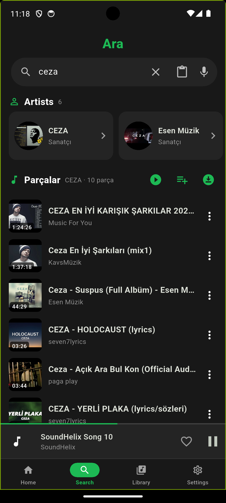
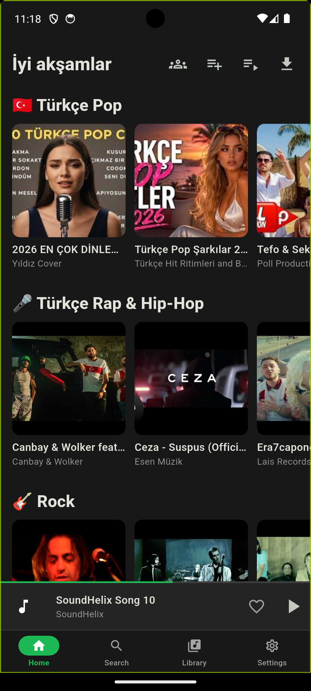
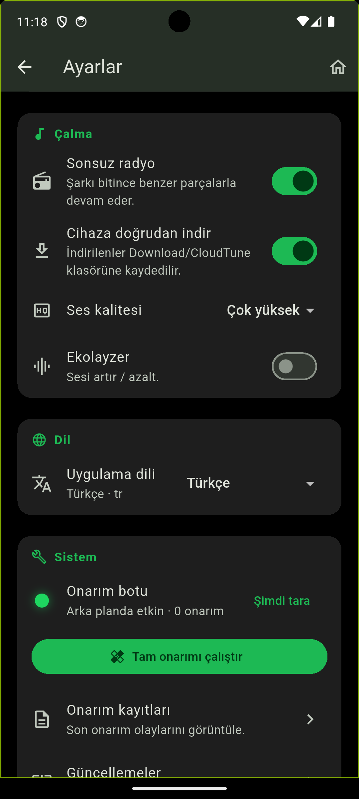
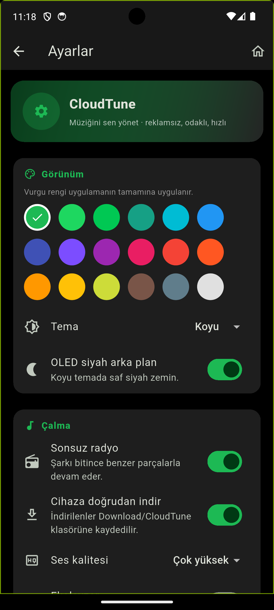

# CloudTune

Açık kaynak, reklamsız müzik çalar. Şarkılar **doğrudan cihazdan YouTube** üzerinden aranır ve çalınır; aracı sunucu, hesap veya abonelik gerekmez.

| Platform | Durum | Paket |
|---|---|---|
| Android 7.0+ (telefon / tablet / katlanabilir) | ✅ | `CloudTune-universal.apk` (tüm ABI'ler) |
| Android arm64 | ✅ | `CloudTune-arm64.apk` |
| Android armv7 | ✅ | `CloudTune-armv7.apk` |
| Android x86_64 | ✅ | `CloudTune-x86_64.apk` |
| Linux x86_64 | ✅ | `CloudTune-linux.deb` (libmpv2 bağımlı), `CloudTune-linux.tar.gz` |
| Windows 11 | ✅ | `CloudTune-windows.zip` — ZIP'i çıkarıp `cloudtune.exe`'yi çalıştırın (3.0.52+253) |
| iOS (AltStore / SideStore) | ⚠️ Eski paket | `CloudTune.ipa`; güncel CI ödeme limiti nedeniyle üretilemedi |

> **Windows 11 kurulumu:** Paket self-contained; `flutter_windows.dll`, `app.so` ve Whisper DLL'leri ZIP içinde. Ek SDK/runtime veya yönetici yetkisi gerekmez. SmartScreen uyarısında *Daha fazla bilgi → Yine de çalıştır* seçin. Sesli arama için mikrofon izni; radyo, oda ve sohbet için ek izin gerekmez.
>
> **Windows güncellemeleri:** Uygulama Windows'ta ZIP indirmez. Yeni sürüm manifestte göründüğünde varsayılan tarayıcıda GitHub sürüm sayfasını (`cloudtune-latest`) açar. Sürüm numarası, `update.json` manifest'i ve Android/Linux/iOS güncelleme akışı değişmez; kullanıcı ZIP'i GitHub release sayfasından alır.
>
> **iOS:** GitHub Actions ödeme limiti nedeniyle IPA eski sürümde kaldı. Android, Linux ve Windows paketleri güncel.

> **Linux ses:** Oynatma motoru `media_kit + libmpv`'dir. `deb` paketi `libmpv2`'ye bağlıdır; `apt` bağımlılığı otomatik kurar. `tar.gz` kullanacaksanız sistemde `libmpv2` bulunmalıdır (`sudo apt install libmpv2`). `just_audio` Linux'ta desteklenmediği için ses motoru platforma göre seçilir.

> **Hangi APK?** Cihazınızın mimarisini bilmiyorsanız `CloudTune-universal.apk`'yı indirin. Uygulama içi güncelleyici cihazın ABI'sini algılar (`Abi.current`) ve doğru paketi seçer; uygun paket yoksa evrensel APK'ya düşer.

---

## Ekran görüntüleri

Cihaz üzerinden alınmış güncel görünümler. Büyütmek için görsele tıklayın.

<p align="center">
  <a href="docs/screenshots/device-01.png"></a>
  <a href="docs/screenshots/device-02.png"></a>
  <a href="docs/screenshots/device-03.png"></a>
  <a href="docs/screenshots/device-04.png"></a>
</p>

<details>
<summary>Tam boyut bağlantılar</summary>

1. [Ekran görüntüsü 1](docs/screenshots/device-01.png)
2. [Ekran görüntüsü 2](docs/screenshots/device-02.png)
3. [Ekran görüntüsü 3](docs/screenshots/device-03.png)
4. [Ekran görüntüsü 4](docs/screenshots/device-04.png)

</details>

---

## İlk kurulum (yeni kullanıcı)

1. [Son sürüm](https://github.com/Arise1881/cloudtune-dist/releases/tag/cloudtune-latest) sayfasından platformunuza uygun dosyayı indirin.
2. Android 7.0+ gerekir. **Bilinmeyen kaynaklardan yükleme** iznini verin (Ayarlar → Güvenlik). Paket imzalı olduğu için Google Play koruması uyarı verebilir; devam edin.
3. APK'yı kurun ve uygulamayı açın. Uygulama doğrudan **ana sayfa** ile açılır; **sonsuz radyo** varsayılan olarak açıktır.
4. İlk açılışta izinler:
   - **Bildirimler** — arka plan çalma ve kilit ekranı kontrolleri için,
   - **Mikrofon** — uygulama açılışta **istemez**; sesli arama düğmesine bastığınızda ister ve yalnızca kayıt süresince aktif kalır,
   - **Depolama** (Android 9 ve altı) — şarkıları `Download/CloudTune` klasörüne kaydetmek için.
5. Ayarlar → **Tema** seçeneğinden *Koyu / Açık / Sistem* modunu seçin. Vurgu rengi ve OLED siyah zemin de buradan ayarlanır.
6. Arama kutusuna şarkı/sanatçı yazın veya bir YouTube bağlantısı yapıştırın. İlk parçayı çaldıktan sonra **yukarıdan aşağıya kaydırarak** ana sayfa ve arama sonuçlarını yenileyebilirsiniz.

İlk açılışta hiçbir hesap, anahtar veya sunucu ayarı gerekmez. Dinleme geçmişi, beğeniler ve çalma listeleri yalnızca cihazda saklanır.

---

## Özellikler

### Çalma
- **Doğrudan YouTube** — arama, video/çalma listesi çözümlemesi ve akış cihazda yapılır
- **Sonsuz radyo** — kuyruk bitmeden ilgili parçalarla genişletilir; tek kaynak düşse de alternatifler denenir
- **Türkiye radyoları** — radio-browser.info kataloğundaki çalışan istasyonlar; HTTPS/HTTP/HLS akışları, arama, istasyon logoları ve çevrimdışı katalog önbelleği. Ana sayfadaki “Türk radyoları” kartından açılır.
- **Hızlı dokunma** — görünen kartların ilk saniyesi arka planda tamponlanır; dokunmada hazır motor devreye girer
- **Tekrar modu** — kapalı / tüm listeyi tekrarla / tek parçayı tekrarla; oynatıcıda döngü ikonuyla değişir
- **Karışık çal** — kuyruğu karıştırır, ikon anında durumu gösterir
- **Ses kalitesi** — düşük / orta / yüksek / lossless itag kısıtı; değişimde aktif parça pozisyonu korunarak yeniden açılır
- **Arka plan çalma** — ekran kilitliyken devam eder; foreground servis duraklatmada kapanmaz, böylece ilk ses/çizirti sorunu oluşmaz
- **Kilit ekranı / bildirim kontrolleri** — şarkı bilgisi, ileri–geri, beğeni, medya tuşları
- **Ekolayzer** — açılışta ve ayar değişiminde uygulanır; parça başına uygulanmadığı için kesilme yapmaz
- **Çizirti önleme** — kaynak değişiminden önce ses kazancı sabitlenir

### Arama ve keşif
- **Metin arama** — şarkı, sanatçı ve YouTube bağlantıları; sonuçlar TTL önbellekte tutulur, gereksiz tekrar araması yapılmaz
- **Yerel Whisper sesli arama** — Google/sistem tanıma servisi kullanılmaz. Mikrofona basıldığında kayıt yapılır; çok dilli `baseQ5_1` modeli cihazda transkript üretir. Otomatik kazanç, gürültü ve yankı filtreleri açıktır; desteklenmeyen UI dillerinde Whisper dili otomatik algılanır. İlk kullanımda model indirilir. Mikrofon **yalnızca** bu akışta açılır; uygulama açılışında izin istenmez, kullanıcı dokununca istenir.
- **Sanatçı parçaları** — arama sonuçlarında “Çalma Listeleri ve Şarkılar” başlığı altında sanatçının tüm parçaları ayrı bir çalma listesi olarak listelenir; “Tümünü indir” ve “Kitaplığıma kaydet” aksiyonları vardır
- **Kişisel ana sayfa** — dinleme geçmişine göre bölümler; içerik kendiliğinden değişmez, zamanlayıcı veya Library bildirimiyle yeniden arama yapılmaz
- **Pull-to-refresh** — ana sayfa ve arama sonuçları **yalnızca** yukarıdan aşağıya kaydırıldığında yenilenir
- **Cihaz bilgisi onayı** — oda katılımı ve başka cihazın bilgilerini görüntüleme kullanıcı onayına bağlıdır

### Kütüphane ve sosyal
- **Çalma listeleri** — oluşturma, adlandırma, silme; liste içi parça sıralaması `ReorderableListView` ile düzenlenir, sıra kalıcıdır
- **Sanatçı profilleri** — sanatçının parçaları ayrı çalma listesi olarak kaydedilir, indirilir ve tek listede çalınır
- **İndirilenler** — Android `Download/CloudTune`, masaüstü Belgeler klasörü; MIME/itag'e göre doğru uzantı (`.webm`/`.m4a`/`.mp3`), sanatçı ve arama grupları ayrı kartlarda, internet olmadan çalınabilir
- **Odalar** — oda listesi (ad, kod, kişi sayısı, kilit durumu), şifresiz odaya tek dokunuşla katılım, davet linkinde şifre, uzaktan katılımcı avatarları
- **Kararlı avatar** — sürümlü dosya adı ve cache key'i; kitaplık/oda avatarı her yeniden çizimde değişmez
- **Dil** — Ayarlar'dan 28 dil seçilebilir ve seçim kalıcıdır; bölgesel kodlar (`pt-BR` vb.) ana dile indirgenir. TR/EN tam çeviri, diğer dillerde arayüz EN'ye düşer ve dil seçicisinin altında `English UI` açıkça gösterilir
- **18 vurgu rengi** kalıcıdır; uygulama kapatılıp açılsa da korunur. Açık/koyu/sistem teması ve OLED siyah zemin de aynı ekranda

### Bakım ve güncelleme
- **Uygulama içi güncelleme** — `update.json` manifestini okur, ABI'ye uygun APK'yı indirir
- **Onarım botu** — akış/indirme/bağlantı hatalarını arka planda sessizce onarır; Ayarlar → **Tam onarımı çalıştır** ile tüm aşamalar zorla koşulur ve sonuç diyaloğu gösterilir
- **Bağlantı desteği** — `youtu.be`, `m.youtube.com`, `music.youtube.com`, `youtube.com`, `www.youtube.com`; Ayarlar'dan açılıp kapatılabilir

Kullanıcıya ham hata mesajı gösterilmez; hatalar Türkçe açıklamalarla eşlenir.

### Onarım zinciri (yerel, ağ trafiği yok)
1. **Oynatma** — akış hatasında parçayı yeniden dene (gerekirse doğrudan akışa geç)
2. **İndirmeler** — başarısız indirmeleri geri çekilmeli yeniden dene
3. **Bekleyen işler** — başarısız bağlantı/arama olaylarını yeniden çalıştır
4. **Tam onarım** — yukarıdaki üç aşamayı tek seferde zorla çalıştır, sayısal sonucu göster

Loglar yalnızca cihazda `repair_bot_logs.json` dosyasına yazılır; e-posta veya uzak servise gönderim yapılmaz.

---

## Android sürüm ve cihaz uyumu

| Android | API | Destek | Not |
|---|---|---|---|
| 7.0 – 7.1 | 24 – 25 | ✅ | `minSdk 24` — Flutter 3.x ve `app_links` alt sınırı |
| 8.0 – 8.1 | 26 – 27 | ✅ | Evrensel veya ABI'ye özel APK |
| 9 – 10 | 28 – 29 | ✅ | Depolama izni `Download/CloudTune` için istenir |
| 11 – 14 | 30 – 34 | ✅ | Bildirim izni, kilit ekranı kontrolleri |
| 15+ | 35+ | ✅ | `targetSdk 36`, `resizeableActivity`, tablet/katlanabilir |

| Mimari | Paket | Cihaz |
|---|---|---|
| `arm64-v8a` | `CloudTune-arm64.apk` | Çoğu modern telefon/tablet |
| `armeabi-v7a` | `CloudTune-armv7.apk` | Eski 32-bit cihazlar |
| `x86_64` | `CloudTune-x86_64.apk` | x86 tablet, emülatör, ChromeOS |
| Tümü | `CloudTune-universal.apk` | Bilinmeyen mimari / GUI indirmede varsayılan |

`minSdk` değeri `android/gradle.properties` içindeki `cloudtune.minSdk=24`'ten okunur. Flutter'ın minSdk migrasyonu `app/build.gradle.kts` dosyasını geri yazsa bile değer korunur. `AndroidManifest.xml` içindeki `supports-screens` (small→xlarge, anyDensity) ve `resizeableActivity=true` telefon, tablet, katlanabilir ve geniş ekran cihazları kapsar.

---

## Dosya haritası (kaynak depo)

```
README.md                  Bu dosya: özellikler, kurulum, uyum, güncelleme, gizlilik
LICENSE                    MIT lisans
pubspec.yaml / pubspec.lock  Flutter bağımlılıkları ve sürüm (3.0.52+253)
analysis_options.yaml      Dart/Flutter linter kuralları
.metadata                  Flutter proje metadata
release.sh                 Build → analyze/test → artifact → GitHub release → push
.gitignore                 Geçici/üretilmiş dosya hariç tutmaları

lib/
  main.dart                Giriş, AudioService init, ThemeData, sistem teması dinleyicisi,
                           uygulama bağlantıları (app_links)
  core/
    app_palette.dart       Tema duyarlı renk paleti (yüzey, metin, ayırıcı, ikon)
    theme_state.dart       Vurgu rengi + çözümlenmiş Brightness (system dahil)
    settings_service.dart  Cihaz içi tercihler (tema, ekolayzer, dil, radyo, indirme)
    speech_service.dart    Yerel Whisper kayıt + transkripsiyon (Google STT yok)
    audio_backend.dart     Platform ses motoru: just_audio (Android/iOS), media_kit+libmpv (Linux)
    player_controller.dart Kuyruk, shuffle/repeat, radyo, ses kalitesi, prefetch
    youtube_service.dart   InnerTube arama önbelleği, sanatçı listesi, akış çözümleme
    library.dart           Geçmiş, beğeniler, sıralı çalma listeleri, sürümlü avatar
    models.dart            Track ve veri modelleri
    download_service.dart  Toplu/grup indirme, doğru MIME uzantısı, çevrimdışı çalma
    update_service.dart    OTA manifest, ABI seçimi, APK indirme/kurulum
    room_service.dart      MQTT oda keşfi, katılım doğrulama, avatar yayını
    repair_bot.dart        Sessiz onarım + uygulama içi tam onarım
    l10n/app_strings.dart  TR/EN çeviri haritası ve LocalizationsDelegate
    link_resolver.dart     YouTube bağlantı çözümleme (5 host)
    link_handler.dart      Uygulama içi bağlantı yönlendirme
    test_tracks.dart       Debug/emülatör test parçaları
  ui/
    home_page.dart         Ana sayfa, arama, sesli arama, feed/sonuç yenileme
    player_page.dart       Tam ekran oynatıcı
    mini_player.dart       Alt mini oynatıcı
    track_tile.dart        Parça satırı
  screens/
    settings_screen.dart   Tema, ekolayzer, bağlantılar, indirme ayarları
    artist_page.dart       Sanatçı parçaları
    playlist_page.dart     Çalma listesi detayı
    my_playlists_page.dart Çalma listelerim (sıralama, oluşturma)
    playlist_editor_page.dart Liste içi parça sıralama/düzenleme
    downloads_page.dart    İndirilenler + sanatçı/arama grupları
    room_page.dart         Oda listesi, katılım, avatar onayı

test/                     Bağlantı, dil, playlist, repeat ve Whisper sözleşmesi testleri
tool/bootstrap.sh          flutter create sonrası Android dosyalarını üret/yamala
tool/patch_android.py      Manifest izinleri, intent-filter, servisler, minSdk yaması
tool/ct_full_test.py       Emülatör kurulum→etkileşim→logcat→ses→ekran raporu
.github/workflows/build.yml   Android CI (Linux paketleri release.sh ile üretilir)
.github/workflows/ios-build.yml   iOS IPA derleme (CI)
.github/workflows/windows-build.yml Windows zip derleme (CI)

android/
  build.gradle.kts, settings.gradle.kts, gradle.properties, gradlew*
  gradle/wrapper/            Gradle wrapper
  local.properties           Yerel SDK yolu (repoya alınmaz)
  app/build.gradle.kts       imza, ABI, sürüm, minSdk=24 (property'den)
  app/src/main/AndroidManifest.xml  İzinler, supports-screens, servis/alıcı, intent-filter
  app/src/debug|profile/AndroidManifest.xml  Debug/profile izinleri
  app/src/main/kotlin/.../MainActivity.kt   Android giriş aktivitesi
  app/src/main/res/          launcher ikonları, splash, tema stilleri, keep.xml,
                             network_security_config.xml, favori ikonları
ios/    Runner, AppDelegate, Info.plist, xcassets, xcodeproj/xcworkspace, Flutter config
linux/  CMakeLists, runner/, flutter/  GTK uygulama ve Flutter embedder
windows/ CMakeLists, runner/, flutter/  Win32 uygulama ve Flutter embedder
web/    index.html, manifest.json, favicon.png, icons/, splash/  PWA runner
```

## Dosya haritası (dağıtım deposu — `cloudtune-dist`)

```
README.md       Kullanıcıya yönelik indirme/kurulum/Gizlilik sayfası (GitHub ana sayfası)
index.html      GitHub Pages indirme portalı (QR kodlar, sürüm kartları, bağlantılar)
update.json     OTA manifest: sürüm, versionCode, notlar, platform → asset URL
apps.json       AltStore/SideStore kaynak dosyası (iOS IPA sürümü)
icon.png        Uygulama ikonu (Pages + DEB masaüstü girişi)
header.png      Pages başlık görseli
apk-qr.png      Android indirme QR kodu
ipa-qr.png      iOS kaynak QR kodu
sidestore-qr.png SideStore QR kodu
video-poster.png Pages video kapak görseli
tunnel.txt      Altyapı notu (Cloudflare tüneli)
```

> Release asset'leri (`CloudTune-*.apk`, `.deb`, `.tar.gz`, `.zip`, `.ipa`) depo
> içinde tutulmaz; GitHub release `cloudtune-latest` etiketinde yayınlanır.
> `update.json` ve `index.html` bu asset'leri işaret eder.

---

## Kurulum sonrası doğrulama

```bash
flutter analyze                       # 0 hata
flutter test                          # tüm birim testleri
ADB_SERIAL=emulator-5554 python3 tool/ct_full_test.py \
    --apk build/app/outputs/flutter-apk/app-debug.apk
# Akış: uninstall → install → deep link (15 test parçası) → arama → mikrofon →
#       shuffle/repeat → oda → logcat crash → media session → ekran görüntüsü
# Rapor: /tmp/opencode/cloudtune-emulator-test/report.json
```

Gerçek kullanıcı simülasyonunda kontrol edilenler: uygulama foreground,
mikrofon **yalnızca** sesli arama dokunuşunda açılıyor, açık temada zemin
açık/metin koyu, arama sonuçlarında “Çalma Listeleri ve Şarkılar” ve
“Arama Sonuçları” başlıkları, shuffle/repeat ikonlarının anında değişimi,
logcat'te crash yok. Linux'ta oynat/duraklat ikonu `PlayerController.playing`
üzerinden anında güncelleniyor.

---

## Derleme

Gereksinimler: Flutter SDK, Android SDK (API 36 — compileSdk/targetSdk), Java 17.

```bash
bash tool/bootstrap.sh          # Android platform dosyalarını üret/yamala
flutter pub get
flutter test
flutter analyze

# Android — tüm cihazlar için evrensel APK
flutter build apk --release

# Android — cihaz başına küçük APK'lar
flutter build apk --release --split-per-abi

# Masaüstü / web
flutter build linux --release   # Release: -s ile strip
flutter build windows --release   # Windows makinede (/GL /LTCG /OPT:REF /OPT:ICF)
flutter build ios --release --no-codesign \
  --obfuscate --split-debug-info=build/ios/symbols  # macOS'ta
flutter build web --release
```

### 3.0.48+249 — Türk radyoları ve anında çalma

- **Tüm Türkiye radyoları:** radio-browser.info canlı kataloğundaki 681
  çalışan istasyon yüklenir; `lastcheckok` filtresiyle yalnızca erişilebilir
  istasyonlar gösterilir. Ana sayfadaki “Türk radyoları” kartından aranabilir.
- **Logo desteği:** katalog favicon'u varsa kullanılır; yoksa istasyon
  domain favicon'u, o da yoksa katalog logosu gösterilir. Medya bildiriminde
  ve listede logo görünür.
- **Akış uyumu:** HTTPS, HTTP ve HLS/M3U8 istasyonları doğrudan akış adresiyle
  çalınır; Android'de düz metin radyo akışlarına izin verildi.
- **Dokunma→ses:** görünen parçalar için hazır oynatıcı havuzu (Wi-Fi 10,
  mobil veri 4) kullanılır. Ölçüm: ilk kart 0,35 sn, üçüncü kart 0,63 sn.
- Doğrulama: `flutter analyze` 0 issue, `flutter test` 89/89, radio servis
  testleri 5/5, temiz debug APK derlendi.

### 3.0.47+248 — oda deneyimi ve ağ optimizasyonu

- **Hızlı davet katılımı:** `http://cloudtune.app/room/KOD?p=sifre` bağlantısı
  açılır açılmaz odaya girer; şifre yalnızca linkte varsa sorulur.
- **Oda eşzamanlılığı:** iki cihaz aynı parçayı çalar; play/pause/next/seek
  her iki yönden de anında yayılır, konum host saatine bağlanır.
- **Sohbet:** giriş artık uygulama içi profil fotoğrafını gösterir; mesajlar
  iki cihazda da anında görünür. Giriş alanı sistem navigasyon çubuğunun
  altına düşmez.
- **Mobil veri / Wi-Fi:** mobil veride kalp atışı 4 sn, presence 16 sn, keşif
  10 sn ve tam sıra yenilemesi 12 tick; Wi-Fi'de 2/8/5/8. Komutlar anında
  kalır. Kapaklar küçük varyantla indirilir, arama önbelleği mobil veride
  daha uzun yaşar.
- **Arama kapakları:** YouTube çalma listesi/arama sonuçlarında gerçek
  miniature'ler görünür; alternatif CDN yedeği korunur.
- **Varsayılanlar:** en yüksek ses kalitesi, ekolayzır açık, normal preset;
  kitaplık/geçmiş/çalma listeleri ve tema korunur.
- **Odalar (Beta):** sekme ve ana sayfa ikonu Beta etiketini taşır.
- Doğrulama: `flutter analyze` 0 issue, `flutter test` 84/84, iki emülatör
  tam testi 13/13 (farklı parçalarla), davet bağlantısı katılımı doğrulandı.

### 3.0.46+247 — arama sonuçları sabit kalır

- Aratılan şarkılar artık kendiliğinden sanatçının diğer parçalarına
  dönüşmüyor. İlk sonuç listesi sabit; ilgili yeni parçalar yalnızca
  yukarıdan aşağıya kaydırıp yenilediğinizde listeye **ekleniyor**.
- Arama kutusu, dil/vurgu rengi tercihleri ve diğer ayarlar değiştirilmedi.
- Doğrulama: `flutter analyze` 0 issue, `flutter test` 73/73, emülatör tam testi 18/18.

### 3.0.45+246 — hızlı parça açılışı

- **Adres çözümü:** InnerTube istemcileri ve Invidious örnekleri artık sırayla
  değil eşzamanlı deneniyor; ilk çalışan yanıt parçayı açıyor. Bir istemci
  takıldığında diğerlerinin 6'şar saniye daha beklemesi kalktı.
- **Parça geçişi:** radyo önerisi arka planda genişletiliyor, sonraki parçayı
  bekletmiyor; geçiş boşluğu 1 sn'den 300 ms'ye indi. Sonraki parça adresi
  4 sn yerine 1,2 sn sonra ısıtılmaya başlanıyor.
- **`play()` zamanı:** motor "hazır" sinyalini bekleme süresi 5 sn'den 1,5 sn'ye
  indi; sinyal gelmese de oynatma deneniyor.
- Doğrulama: `flutter analyze` 0 issue, `flutter test` 71/71, emülatör tam testi 18/18.

### 3.0.44+245 — temiz kurulum varsayılanları ve ekran galerisi

- **Ana sayfa açılışı:** uygulama artık arama sekmesi yerine doğrudan ana sayfa ile başlar; aramaya üstteki büyüteçten veya alt nav’dan geçilir.
- **Sonsuz radyo:** ilk kurulumda açık gelir. Sürüm yükseltmesinde tek seferlik varsayılan uygulanır, sonraki açılışlarda kullanıcı tercihi korunur; beğeni/geçmiş/çalma listeleri sıfırlanmaz.
- **README:** cihazdan alınmış dört ekran görüntüsü `docs/screenshots/` altına eklendi ve galeri olarak gösteriliyor.
- Doğrulama: `flutter analyze` 0 issue, `flutter test` 66/66, emülatör tam testi 18/18.

### 3.0.43+244 — iki cihazlı oda senkronu

- Oda state artık `seq`, `sentAt` ve `hostId` taşır; QoS1 tekrarı veya gecikmiş paket eski parçayı geri getirmez. Host değişiminde yeni state üstünlük kazanır.
- Katılımcı tarafında kullanıcı shuffle tercihi oda kuyruğuna uygulanmaz. Böylece aynı parça her 3 saniyede baştan başlamaz; kuyruk ve index host ile birebir kalır.
- Aynı parça görünürse bile kaynak hatası varsa joiner parçayı yeniden açar; `stopped` ve `playing` komutları açık uygulanır.
- Ana sayfaya dönüşte bağlı olmayan `ScrollController` üzerinde `animateTo()` çağrısı engellendi; emülatör tam testi 18/18, `flutter analyze` 0 issue, `flutter test` 66/66.

### 3.0.42+243 — müsify benzeri arama ekranı

- Ortalanmış açık mavi **Ara** başlığı; koyu gri yuvarlatılmış arama çubuğu büyüteç, metin ve X temizle ikonu ile çalışır.
- **Artists:** tekil sanatçılar yuvarlak avatar, `Sanatçı` alt metni ve `>` ile yatay listede; dokununca sanatçı sayfasına gider.
- **Parçalar:** kare kapak, sol alt süre rozeti (`00:34`, `1:00:14`), taşan başlıkta `...`, sanatçı alt metni ve dikey 3 nokta menü. Menüde çal, radyo, beğeni, indirme, sanatçı ve çalma listesine ekleme bulunur.
- **Çalma Listeleri / Radyolar:** arama ekranından kayıtlı listeler çalınabilir, sanatçı kartlarından radyo başlatılabilir; alt nav Home / **Search** / Library / Settings (aktif Search mavi oval).
- **Library eski hâlinde:** Library sekmesi `RoomPage(initialTab: 1)` ile profil/avatar ayarlarını, beğenileri ve dinleme geçmişini açar. Çalma listeleri arama ekranındaki kartlardan ve ana sayfa üst ikonundan erişilebilir. Veri modeli ve kayıt anahtarları değişmedi.
- **Vurgu rengi:** arama başlığı, bölüm ikonları, aktif Search ovali, mikrofon ve beğeni simgeleri `ThemeState.value`'dan okunur; seçilen renk kapanıp açılsa da arama dahil tüm UI aynı renkte kalır.
- Doğrulama: `flutter analyze` 0 issue, `flutter test` 65/65, UI sözleşme testi eklendi.

### 3.0.41+242 — kullanıcı sorunları ve tam emülatör testi

- **Vurgu rengi:** seçim `ct.accentColor` anahtarında saklanır, açılışta geri yüklenir; profil kartı ve tüm palet anında güncellenir.
- **Oda:** state artık çaların gerçek kuyruğundan üretilir; parça kimliği bazlı index çözümü, açık `stopped` durumu, `state_request`, host transfer sonrası state yayını ve `play`/`pause` komutları eşzamanlı çalmayı düzeltir. Davet linki `http://cloudtune.app/room/KOD?p=sifre` biçimindedir; http/https/eski custom şemalar ayrıştırılır.
- **Dil:** 28 kodun tamamı seçilebilir, bölgesel kodlar normalize edilir, seçim hemen yazılır; fallback `English UI` ile belirtilir.
- **Sesli arama:** `baseQ5_1` Whisper modeli, 16 kHz mono kayıt, AGC/gürültü/yankı filtreleri, desteklenmeyen dilde `auto` algılama ve tek seferlik segment birleştirme.
- **Radyo:** hata sonrası otomatik sonraki parça, 50 parça üretim sınırının kaldırılması, HEAD yerine Range-GET doğrulama ve yalnızca YouTube host'larına özel header'lar. “Radyo olarak çal” tercih kapalıyken de radyoyu açar.
- **Oynatıcı:** `just_audio` header proxy'si kapatıldı; 127.0.0.1 cleartext proxy kaynaklı `Source error` giderildi. Genel HTTPS/wss politikası korunuyor.
- **Doğrulama:** `flutter analyze` 0 issue, `flutter test` 61/61, emülatör tam testi 18/18 (`no_ui_playback_error` dahil), logcat'ta cleartext hatası 0.

Windows/iOS ikili paketleri GitHub billing/spending limiti nedeniyle eski sürümde kaldı; limit düzelince dispatch ile yenilenecek.

### 3.0.40+241 — platform optimizasyonları

- **Android:** R8 minify + `shrinkResources` açık; JNI/Flutter keep kuralları
  `android/app/proguard-rules.pro` içinde. ABI bazlı APK'lar 20–26 MB
  (önceki evrensel 64 MB). Düz metin (HTTP) trafiği kapalı, tüm uç noktalar
  HTTPS/wss. Gradle heap 4G'ye indirildi; CI artık `bootstrap.sh` ile manifesti
  yeniden üretmiyor.
- **Linux:** Release ikilisi stripped; `libmpv.so.2` bundle'a kopyalanıp `ldd`
  ile doğrulanıyor. deb sürümü `3.0.40-241`, `Depends: libmpv2 (>= 0.35)`,
  `StartupWMClass=com.cloudtune.app` ve `/usr/bin/cloudtune` symlink'i var.
  tar.gz içinde kendi dizininden çalışan `.desktop` + ikon bulunuyor.
- **Windows:** MSVC Release `/GL /LTCG /OPT:REF /OPT:ICF`; zip içinde
  `flutter_windows.dll` zorunlu runtime dosyası korunuyor, yalnızca `.pdb`
  sembolleri hariç. Runner.rc version resource kaçışları düzeltildi.
- **iOS:** İmzasız AltStore IPA'sı `--obfuscate --split-debug-info` ile
  küçültülüyor; Payload klasörü paketlemeden önce temizleniyor. İmzalı
  App Store dağıtımı için ayrı sertifika/profile gerekir.
- **Oda:** `presence_request` ile anlık avatar/state senkronu, host doğrulamalı
  ack, doğru kişi sayısı, odadan çıkınca avatar/discovery temizliği.

Windows/iOS ikili paketleri mevcut GitHub billing/spending limiti nedeniyle
eski sürümde kaldı; limit düzelince dispatch ile yenilenecek.

Sürüm yayınlama (APK + Linux + GitHub release + `update.json` + `apps.json` + Pages):

```bash
bash release.sh patch           # major | minor | patch | current
```

`release.sh` şunları yapar: `pubspec.yaml` sürümünü artırır, analyze/build çalıştırır, arm64/armv7/x86_64/universal APK + deb/tar.gz hazırlar, GitHub release asset'lerini günceller, dağıtım reposundaki `update.json`, `apps.json`, `index.html`, `README.md` dosyalarını push eder, kaynak repoyu push eder ve iOS/Windows CI iş akışlarını tetikler.

---

## Güncelleme mekanizması

Uygulama açılışta şu manifesti okur:

```
https://raw.githubusercontent.com/Arise1881/cloudtune-dist/main/update.json
```

Manifest `version`, `versionCode`, `notes` ve `platforms` alanlarını içerir. Android için `android-arm64`, `android-armv7`, `android-x86_64` ve `android-universal` bağlantıları bulunur. Güncelleme indirilmeden önce cihazın ABI'si belirlenir; uygun paket yoksa evrensel paket kullanılır.

Windows'ta akış farklıdır: `applyUpdate()` paket indirmez, varsayılan tarayıcıda
`https://github.com/Arise1881/cloudtune-dist/releases/tag/cloudtune-latest`
adresini açar. Sürüm, `update.json` ve diğer platformların güncelleme akışı
değişmez; ZIP yalnızca GitHub release sayfasından indirilir.

Aynı manifest GitHub Pages üzerinden de yayınlanır:
`https://arise1881.github.io/cloudtune-dist/update.json` (CDN önbelleği nedeniyle raw bağlantı her zaman güncel kaynaktır).

---

## Gizlilik

Dinleme geçmişi, beğeniler, çalma listeleri, avatar, indirilenler, Whisper transkriptleri ve dil tercihi **yalnızca cihazda** saklanır. Uygulamanın çalışması için PC veya özel sunucu gerekmez; YouTube/Invidious ve MQTT dış servisleri doğrudan cihazdan erişilir. Mikrofon yalnızca siz sesli arama düğmesine bastığınızda açılır; kayıt cihazda transkribe edilir, ses/sunucuya gönderilmez. Onarım botu logları da cihazda kalır; e-posta veya uzak servise veri gönderilmez. Başka cihazın oda bilgilerini görmek kullanıcı onayına bağlıdır.

## Altyapı

Cloudflare tüneli ve worker'ları: [`cloudflare/README.md`](cloudflare/README.md)

## Lisans

MIT — bkz. [LICENSE](LICENSE).
